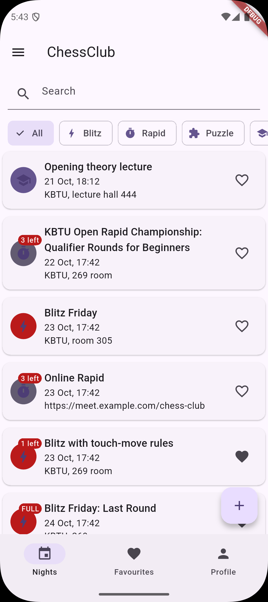
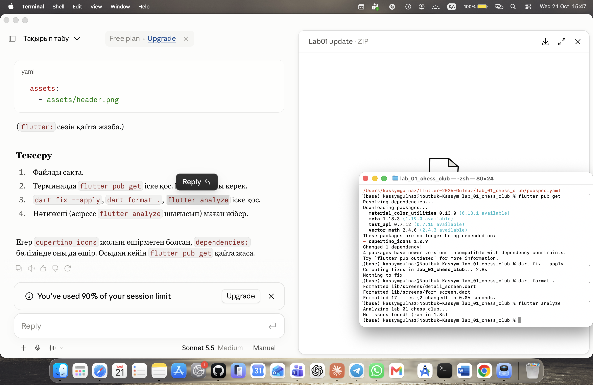

# ChessClub

A small Flutter app for a university chess club. Each **night** (an evening
of blitz, a rapid tournament, a lecture, a puzzle session or a simul) has a
title, a category, a start time, a limited number of boards, a list of
players, and an optional set of rules. A night can be online, in which case
its place is a meeting link. Everything lives in memory: no network, no
storage.

The app has three tabs (nights, favourites, profile), a drawer (About and
Reset data), a detail screen for every night and one form that creates and
edits nights.

## Screenshots

| Phone, light | Phone, dark | Tablet grid |
| --- | --- | --- |
|  |  |  |

## Decisions

The list of nights and the profile live in the State of the shell, and the
tabs get them as constructor parameters and send every change up through
callbacks, so the favourites tab and the "You are on N lists" line always
read the same single source of truth. The detail screen takes callbacks in
its route arguments because a pushed route sits above the shell and cannot
reach its State; it keeps a local copy of the night so it updates at once,
and tells the shell about every change. The form returns a value through
`Navigator.pop` instead of changing the list itself, so it does not need to
know who opened it, and backing out simply returns nothing. The list is a
`GridView` on wide screens and a `ListView` on phones, and the choice is made
by a `LayoutBuilder` because it must follow the width the list really gets,
not the width of the whole window. `PopScope` compares the current field
values with the ones the form opened with, so typing something and then
typing it back counts as clean and no dialog appears. With the tools of
week 9 I would move the list and the profile out of widget State into a
separate store, add persistence, and replace the callback chains with it.

## Run

```bash
flutter pub get
flutter run
flutter analyze
dart format .
```
