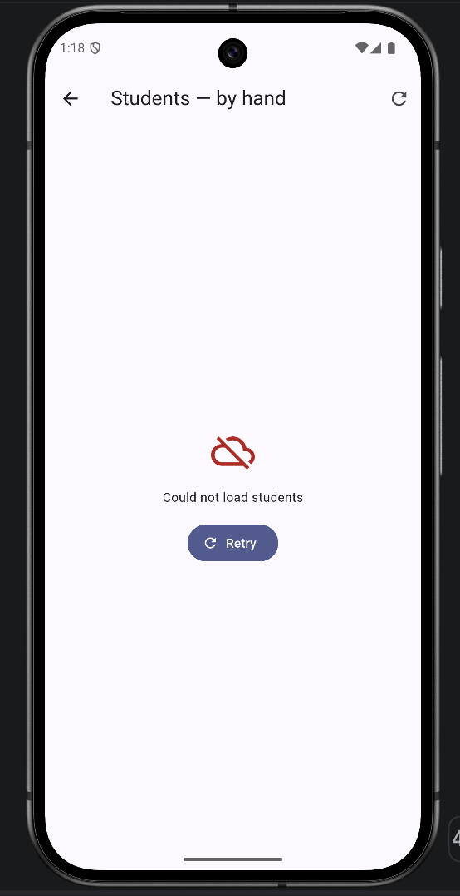
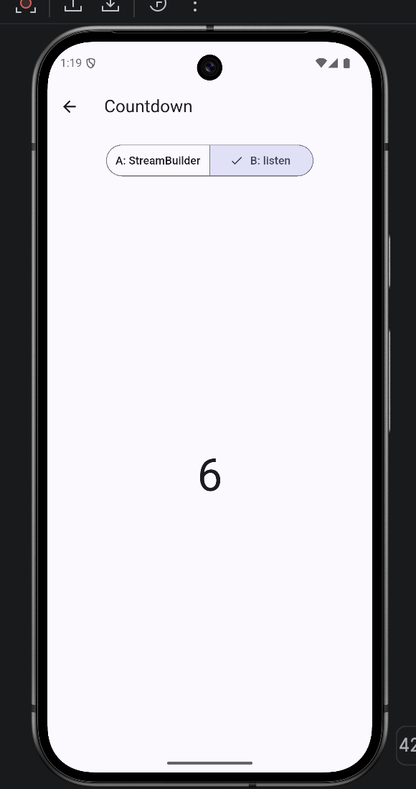

# students_async — Practice 10: The Data Arrives Later

A Flutter app that builds a Students screen around a fake API that is slow
(2 seconds) and fails every third call. The lab covers what happens to the
line after `await`: the user may have left, the server may have said no, and
the widget may be gone.

## Run

```bash
flutter pub get
flutter analyze   # No issues found! (unawaited_futures: true)
flutter run
```

The home screen has three ways in: **By hand**, **FutureBuilder**, **Countdown**.

## Levels

| Level | Topic | Where |
|-------|-------|-------|
| 1 | A fake API that fails: `Future.delayed`, `throw`, event loop order | `lib/api/fake_api.dart` |
| 2 | Four states by hand: loading, error, empty, data; `mounted` after every `await` | `lib/students_screen.dart` |
| 3 | FutureBuilder done right: the Future is a field, `hasError` first, a Switch that does not reload | `lib/students_future_screen.dart` |
| 4 | A countdown two ways: `async*` + `StreamBuilder`, and `listen` + `cancel()` in `dispose` | `lib/countdown_screen.dart`, `lib/api/countdown.dart` |
| 5 | Errors that do not vanish: awaited Save, `try / on StateError`, `context.mounted`, pop only on success | `lib/students_screen.dart` |

## Project structure

```
lib/
  main.dart                    MaterialApp → HomeScreen
  home_screen.dart             navigation to the three screens
  api/fake_api.dart            Student, NoConnectionException, FakeApi
  api/countdown.dart           Stream<int> countdown(int from)
  students_screen.dart         by-hand states + Save button
  students_future_screen.dart  FutureBuilder version
  countdown_screen.dart        version A (StreamBuilder) and B (listen)
  widgets/                     LoadingView, ErrorView, EmptyView, StudentList
```
## Screenshots

| Error view with Retry | Countdown, version B |
|---|---|
|  |  |

## Notes

Predicted vs actual event order, the error messages and the countdown
observations are in [NOTES.md](NOTES.md).